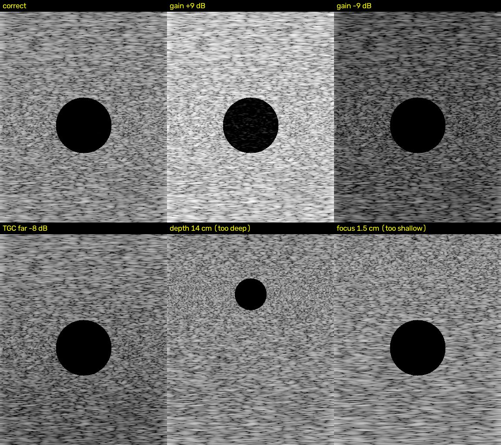

# Ultrasound settings benchmark

How small a gain, depth, TGC or focus error can software detect from the captured ultrasound
screen? Nobody has published that number. This repo measures it.

The scanner (a GE cart) outputs its display over HDMI into a capture card. Everything here runs on
that video on a laptop: the machine is a dumb video source, and no vendor cooperation is needed.

```
GE cart --HDMI--> capture card --> frames --> regions (image area + settings strip)
                                      |--> ocr: gain / depth / freq / preset read from the strip  (ground truth)
                                      |--> detectors: gain, tgc, depth, focus                     (what a coach would see)
                                      '--> benchmark: smallest separable error per control
```

Why "read it from the screen": the settings strip is burned into the video, so the knob value is
known exactly for every frame, free, with no DICOM and no API. The detectors never see the strip;
they only see the image area. The benchmark asks whether the image alone gives the error away.

## Layout

| Path | What |
|---|---|
| `src/usbench/frames.py` | capture card, video file or image folder, all yielding BGR frames |
| `src/usbench/regions.py` | image-area and strip rectangles, picked once per machine, saved as JSON |
| `src/usbench/ocr.py` | Tesseract on the strip plus regex parsing; `parse_settings` is pure text and unit-tested |
| `src/usbench/detectors/` | `gain` (saturation, dark blocks, percentiles), `tgc` (row profile slope and residual), `depth` (anechoic target bottom as a fraction of screen height), `focus` (lateral speckle correlation width per depth band) |
| `src/usbench/features.py` | one call for all detector numbers, and which features may answer for which control |
| `src/usbench/synth.py` | synthetic B-mode frames with known knob errors, for testing the pipeline before any capture |
| `src/usbench/benchmark.py` | per-level threshold fit on half the frames, scored on the other half, smallest separable error per control |
| `scripts/pick_regions.py` | drag the two rectangles on a live frame |
| `scripts/read_strip.py` | print what OCR reads off the strip right now |
| `scripts/record_sweep.py` | lab-day recorder: set knob, press Enter, N frames saved and labelled |
| `scripts/make_synthetic.py`, `scripts/run_benchmark.py` | build the synthetic set, score any manifest |
| `docs/LAB_DAY.md` | the phantom afternoon, step by step |

## Setup

```
python -m venv .venv
.venv\Scripts\python -m pip install -e .[ocr,dev]
```

OCR also needs the Tesseract binary: https://github.com/UB-Mannheim/tesseract/wiki (Windows
installer). Point to it with `--tesseract` or the `TESSERACT_CMD` environment variable if it is not
on PATH. Everything except OCR runs without it.

## Run it on synthetic frames

```
.venv\Scripts\python scripts\make_synthetic.py --out data\synthetic --frames 40
.venv\Scripts\python scripts\run_benchmark.py --manifest data\synthetic\manifest.csv --out outputs\synthetic
.venv\Scripts\python -m pytest
```

The synthetic result is a plumbing check, not a finding. The synthetic frames are a physics
cartoon (Rayleigh speckle, exponential attenuation, a Gaussian lateral blur that widens away from
the focus, one cyst) and the smallest error they separate is just the smallest step in the sweep.
The numbers that matter come from the phantom.



## The benchmark's one number

For each control the sweep records frames at the correct setting and at several wrong ones. For
each wrong level, one detector feature and one threshold are fitted on half the frames and scored
on the other half. The smallest separable error is the smallest error magnitude at which every
level of that magnitude is told from correct with at least 0.90 balanced accuracy. It is the
detector's resolution in the knob's own units: "plus or minus 2 dB of gain", "2 cm of depth".

A per-level threshold is an upper bound on what a single coach rule could do with the same
features. It answers "is this difference visible at all", which is what the benchmark is for;
building the rule comes after.

## Manifest format

One row per frame; `scripts/record_sweep.py` writes it, `scripts/run_benchmark.py` reads it.

```
path,control,level,correct,error,unit
gain/50/20261101_000.png,gain,50,1,0,%
gain/60/20261101_000.png,gain,60,0,10,%
```

`level` is the signed knob value, `correct` is 1 at the correct setting, `error` is the absolute
deviation in the control's units. Paths are relative to the manifest.

## What transfers from phantom to patient

Gain, depth and focus are judged by within-image ratios (anechoic floor, target bottom as a
fraction of screen height, speckle width), so they do not depend on patient size. TGC does: a
phantom attenuates uniformly, a patient does not, so the phantom can only answer whether a TGC
error is visible, not what correct TGC looks like on a person. A small volunteer validation
belongs between the phantom benchmark and any learner study.
